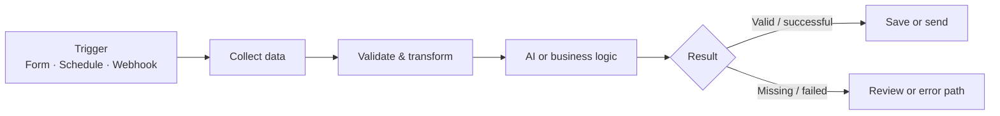

<div align="center">

# n8n Workflow Automation Portfolio

### Practical automations with n8n, AI models, APIs, and business tools

I build workflows that connect business processes with AI — from invoice validation and lead qualification to document Q&A and content operations.

[Explore Projects](#-featured-projects) · [Getting Started](#-run-a-workflow) · [Testing & Security](#-testing--security) · [Connect with Omkar](#-about)


</div>

---

## 👋 What this repository demonstrates

A portfolio of six n8n workflow examples showing how AI models, APIs, webhooks, and everyday business tools can work together.

- **Business process automation** — extract, validate, route, and record information.
- **AI integrations** — connect Gemini or OpenAI models to defined workflow steps.
- **API and webhook handling** — exchange data between services.
- **Operational thinking** — document configuration, failure paths, security considerations, and tests.

> These are portfolio examples, not turnkey production systems. Review each project guide, configure your own accounts, and test with safe sample data before use.

## 🚀 Featured projects

<table>
  <tr>
    <td width="50%" valign="top">
      <h3>01 · AI Invoice Processing</h3>
      <p>Extract invoice fields, validate required values, check for possible duplicates, and route records for processing or review.</p>
      <p><strong>Stack:</strong> n8n · Google Gemini · Google Drive · Sheets · Gmail</p>
      <a href="./workflows/01-ai-invoice-processing/">Project guide & workflow →</a>
    </td>
    <td width="50%" valign="top">
      <h3>02 · AI Voice Lead Qualification</h3>
      <p>Start an AI voice call for an eligible lead and process call outcomes through a webhook.</p>
      <p><strong>Stack:</strong> n8n · Vapi · Webhooks · Google Sheets</p>
      <a href="./workflows/02-ai-lead-qualification/">Project guide & workflow →</a>
    </td>
  </tr>
  <tr>
    <td width="50%" valign="top">
      <h3>03 · RAG Document Agent</h3>
      <p>Index PDF content in a vector store and answer questions using retrieved document context.</p>
      <p><strong>Stack:</strong> n8n · OpenAI · Embeddings · Pinecone</p>
      <a href="./workflows/03-rag-document-agent/">Project guide & workflow →</a>
    </td>
    <td width="50%" valign="top">
      <h3>04 · AI Lead Capture</h3>
      <p>Capture an enquiry, draft a welcome email, save lead details, and route configured notifications.</p>
      <p><strong>Stack:</strong> n8n · Gemini · Google Sheets · Gmail · Slack</p>
      <a href="./workflows/04-ai-lead-capture/">Project guide & workflow →</a>
    </td>
  </tr>
  <tr>
    <td width="50%" valign="top">
      <h3>05 · Department Intelligence Agent</h3>
      <p>Collect news data, summarize relevant items, and prepare department-specific email briefings.</p>
      <p><strong>Stack:</strong> n8n · HTTP Request · Gemini · Gmail</p>
      <a href="./workflows/05-department-intelligence-agent/">Project guide & workflow →</a>
    </td>
    <td width="50%" valign="top">
      <h3>06 · AI Content Generation</h3>
      <p>Generate social copy and image content, publish through configured integrations, and log outputs.</p>
      <p><strong>Stack:</strong> n8n · Gemini · Pollinations.ai · LinkedIn · Facebook · Sheets</p>
      <a href="./workflows/06-ai-content-generation/">Project guide & workflow →</a>
    </td>
  </tr>
</table>

## 🖼️ Workflow screenshots

These screenshots show the workflow layouts in n8n. Open a project guide to review its nodes, connections, configuration, and testing notes.

<table>
  <tr>
    <td width="50%" valign="top">
      <h3>AI Invoice Processing</h3>
      
      <p><a href="./workflows/01-ai-invoice-processing/">View project guide →</a></p>
    </td>
    <td width="50%" valign="top">
      <h3>AI Voice Lead Qualification</h3>
      
      <p><a href="./workflows/02-ai-lead-qualification/">View project guide →</a></p>
    </td>
  </tr>
  <tr>
    <td colspan="2" valign="top">
      <h3>RAG Document Agent</h3>
      
      <p><a href="./workflows/03-rag-document-agent/">View project guide →</a></p>
    </td>
  </tr>
</table>

> Screenshots are visual references; they do not by themselves prove that a workflow ran successfully. See each project guide for setup and testing instructions.

## 🧭 How the workflows fit together

The projects follow a common automation pattern. Individual projects may use only some of these stages.



## 🛠️ Tools used

<p>
  
  
  
  
  
  
  
  
</p>

## ▶️ Run a workflow

1. **Choose a project** from the cards above and read its README and architecture note.
2. **Import the JSON** into your n8n instance using the workflow import option.
3. **Configure credentials** for the services used by that workflow.
4. **Replace example values** such as sheet IDs, folder IDs, phone numbers, and platform-specific IDs.
5. **Run with test data** and inspect each node's output and the connected service.
6. **Keep the workflow inactive** until you have verified the success and failure paths.

All exported workflows are inactive by default. Some integrations require additional setup; follow the project's Configuration section.

### Environment configuration

Some HTTP request nodes use environment expressions:

- **AI Lead Qualification:** `VAPI_ACCESS_TOKEN`, `VAPI_ASSISTANT_ID`, `VAPI_PHONE_NUMBER_ID`
- **AI Content Generation:** `FACEBOOK_PAGE_ID`, `FACEBOOK_ACCESS_TOKEN`

Your n8n hosting setup must allow the relevant environment-variable expressions. Where that is unavailable, use a supported credential configuration. Never commit real credentials or a populated `.env` file.

## ✅ Testing & security

The repository's GitHub Actions workflow checks JSON syntax, basic workflow structure, inactive exports, expected README files, and several common secret patterns.

**These automated checks do not execute workflows or confirm that live integrations work.** Use the manual test guidance and project-specific test cases:

- [Testing strategy](./docs/testing/testing-strategy.md)
- [Deployment guide](./docs/deployment/deployment-guide.md)
- [Security practices](./docs/security/security-practices.md)
- [Invoice test cases](./tests/invoice-processing/test-cases.md)
- [Lead qualification test cases](./tests/lead-qualification/test-cases.md)
- [RAG agent test cases](./tests/rag-agent/test-cases.md)

Before using a workflow with real data, test missing inputs, invalid model output, API failures, duplicate events where relevant, and downstream storage errors. Use synthetic or non-sensitive data whenever possible.

**Credential history note:** The security guide records that an earlier social-content workflow contained a Facebook access token. If it was real, revoke or rotate it. Removing a secret from the current file does not remove it from earlier Git commits; review repository history if needed.

## 📁 Repository structure

```text
workflows/
├── 01-ai-invoice-processing/
├── 02-ai-lead-qualification/
├── 03-rag-document-agent/
├── 04-ai-lead-capture/
├── 05-department-intelligence-agent/
└── 06-ai-content-generation/

docs/
├── architecture/
├── deployment/
├── security/
└── testing/

tests/
├── invoice-processing/
├── lead-qualification/
└── rag-agent/
```

## 👨‍💻 About

**Omkar Shelke** · AI Automation Engineer · Pune, India

I build workflow automations using n8n, AI models, APIs, webhooks, and business tools, alongside RPA experience with UiPath and Power Automate.

- [GitHub profile](https://github.com/OmkarShelke-Project07)
- [Email](mailto:shelkeomkar00@gmail.com)
- [LinkedIn](https://www.linkedin.com/in/omkar-shelke07/)

---

<div align="center">
  <sub>Built to demonstrate practical workflow design. Configure, test, and verify before production use.</sub>
</div>
